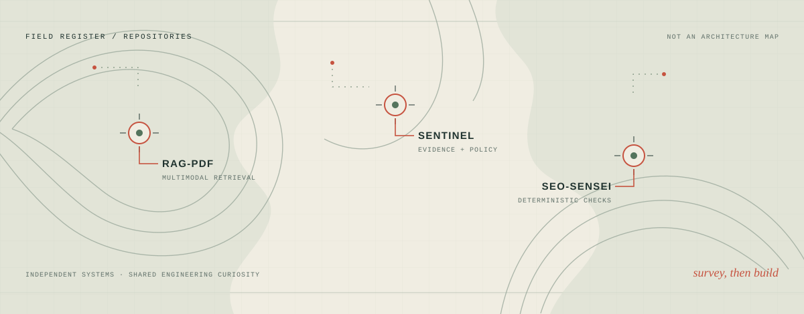
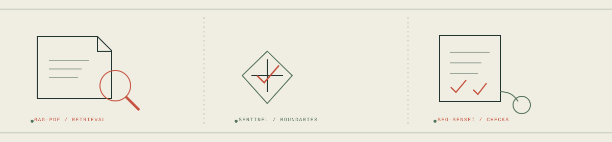

# Rakshak D

## Engineering Field Atlas

*Systems, investigated in the field.*

I work across AI/ML and application engineering, with a focus on retrieval, automation, evidence, and repeatable evaluation.

<picture>
  <source media="(prefers-color-scheme: dark)" srcset="assets/survey-hero-dark.svg">
  <source media="(prefers-color-scheme: light)" srcset="assets/survey-hero-light.svg">
  
</picture>

*Separate repositories, read as field sites. This map is an editorial index, not a combined architecture.*

## Engineering studies

### [RAG-PDF](https://github.com/Rakshak-D/rag-pdf)

**Active development.** Multimodal PDF retrieval with evaluation work; the advanced branch work remains in progress.

### [Sentinel](https://github.com/Rakshak-D/sentinel)

A local-first automation foundation with a CLI, evidence capture, and explicit policy boundaries.

### [SEO-Sensei](https://github.com/Rakshak-D/SEO-Sensei)

Evidence-first SEO analysis with deterministic checks and optional AI. Redesign and verification work is ongoing.

<picture>
  <source media="(prefers-color-scheme: dark)" srcset="assets/survey-projects-dark.svg">
  <source media="(prefers-color-scheme: light)" srcset="assets/survey-projects-light.svg">
  
</picture>

*Three project subjects, drawn as independent plates. The Markdown descriptions carry the project details.*

## Applications and prototypes

### [AURA](https://github.com/Rakshak-D/AURA)

A self-hosted task-and-reminder application foundation, with optional local AI.

### [RazorResolve](https://github.com/Rakshak-D/razorresolve)

A synthetic-data financial-reconciliation prototype with a deterministic workflow and tests.

### [CLASSROOMS](https://github.com/Rakshak-D/CLASSROOMS)

A Django application for classroom booking and management.

### [Finora](https://github.com/Rakshak-D/Finora)

A market-event intelligence application under development.

## Early-stage investigation

### [Seyvo](https://github.com/Rakshak-D/seyvo)

An early-stage incident-investigation concept documented in architecture notes; its core investigator is not implemented.

## Small experiment

[RPS-Vision](https://github.com/Rakshak-D/RPS-Vision) is a small, optional computer-vision experiment.

