  <picture>
    <source media="(max-width: 600px)" srcset="assets/hello-mobile.svg" />
    
  </picture>

<kbd>01 / ABOUT</kbd>

## Behind the builds

**Rakshak D** · B.E. Artificial Intelligence & Machine Learning · Malnad College of Engineering, Hassan · **Graduating 2027**.

I build with **retrieval, local models, and automation**. I like testing what works and making software enjoyable to use.

<picture>
  <source media="(max-width: 600px)" srcset="assets/now-mobile.svg" />
  
</picture>

<kbd>02 / SELECTED WORK</kbd>

## On the workbench

  
  
  

**[More projects →](https://github.com/Rakshak-D?tab=repositories)**

<kbd>03 / TOOLBOX</kbd>

## Tools of the trade

<picture>
  <source media="(max-width: 600px)" srcset="assets/toolbox-mobile.svg" />
  
</picture>

<kbd>04 / CONNECT</kbd>

## Elsewhere

  
  
  

<picture>
  <source media="(max-width: 600px)" srcset="assets/footer-mobile.svg" />
  
</picture>
