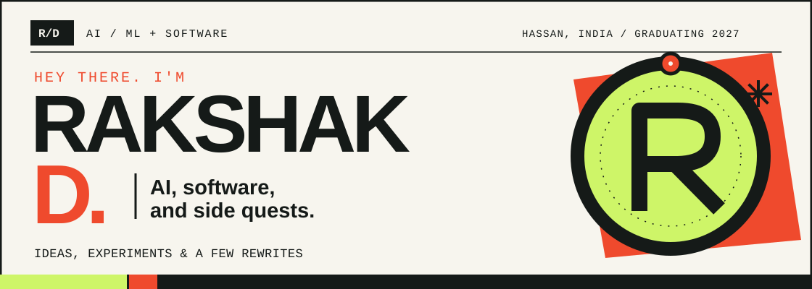
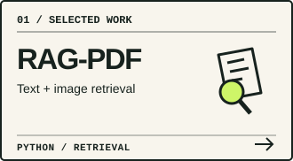
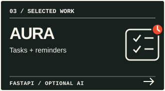
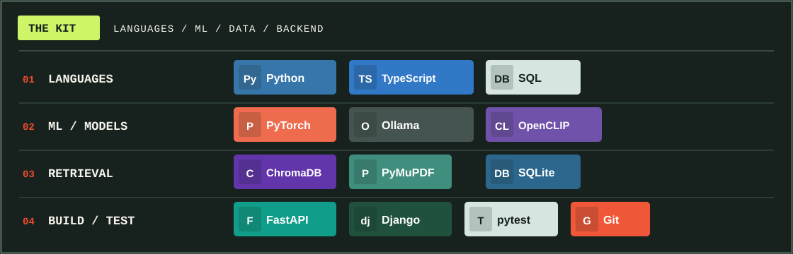

  

01 / ABOUT

## Behind the builds

**Rakshak D** · B.E. Artificial Intelligence & Machine Learning · Malnad College of Engineering, Hassan · **Graduating 2027**.

I build with **retrieval, local models, and automation**. I like testing what works and making software enjoyable to use.

02 / SELECTED WORK

## On the workbench

  
  
  

[More projects](https://github.com/Rakshak-D?tab=repositories)

03 / TOOLBOX

## Tools of the trade

  <picture>
    <source media="(max-width: 600px)" srcset="assets/toolbox-mobile.svg" />
    
  </picture>

Technology list

**LANGUAGES**: Python · JavaScript · TypeScript · C++ · SQL

**AI & LLMs**: PyTorch · Hugging Face · LangChain · Ollama · OpenCLIP · scikit-learn

**RETRIEVAL & DATA**: ChromaDB · FAISS · PyMuPDF · SQLite · NumPy · Pandas

**APPS & TOOLING**: FastAPI · Django · React · Docker · Git · pytest · GitHub Actions · n8n

04 / CONNECT

## Elsewhere

  
  
  

